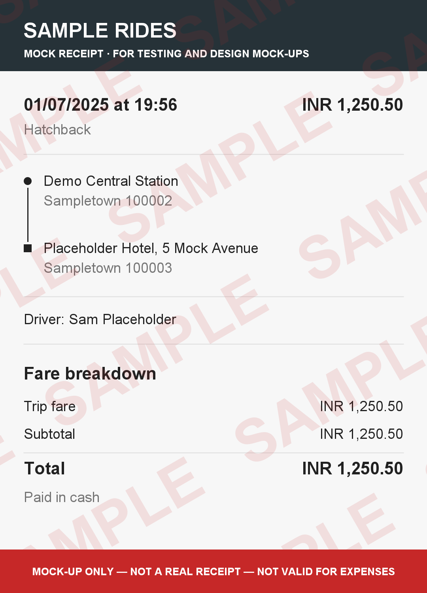

## Mock Receipt Maker

[](https://github.com/Akash-Mittal/uber-invoice-maker/actions/workflows/build.yml)
[](LICENSE)

A small Spring Boot learning project: upload a CSV of trips and get back one **unbranded, watermarked
sample ride receipt** per row, handy for UI mock-ups, demos and test fixtures.

> Every generated image is tiled with a `SAMPLE` watermark and carries a "Mock-up only, not a real
> receipt, not valid for expenses" banner. The project deliberately doesn't imitate any real company's
> receipts. Please don't use its output as proof of travel or for expense claims.



### Tech

* Java 21, Spring Boot 4.1 (Web MVC, Thymeleaf, Validation)
* Apache Commons CSV 1.14
* Java2D for rendering, with no external image template
* JUnit 5, AssertJ and MockMvc for tests
* GitHub Actions CI

### Run it

```bash
./mvnw spring-boot:run        # Windows: mvnw.cmd spring-boot:run
```

Open <http://localhost:9090/>, choose a CSV and click **Generate receipts**. The generated PNGs are listed on
the page and written to `generated-receipts/`, which is cleared of old `*.png` files at each startup.

Run the tests with `./mvnw verify`.

### CSV format

The first row must be a header. Column names are case-insensitive, column order doesn't matter, and extra
columns are ignored. See [`src/test/resources/sample.csv`](src/test/resources/sample.csv).

| Column         | Example                  |
|----------------|--------------------------|
| `fromAddress1` | `12 Example Street`      |
| `fromAddress2` | `Sampletown 100001`      |
| `toAddress1`   | `Demo Central Station`   |
| `toAddress2`   | `Sampletown 100002`      |
| `amount`       | `1250.50` (or `1,250.50`)|
| `dateTime`     | `01/07/2025 at 19:56`    |
| `carType`      | `Hatchback`              |
| `driverName`   | `Sam Placeholder`        |

### Configuration (`application.properties`)

| Property                               | Default              | Meaning                              |
|----------------------------------------|----------------------|--------------------------------------|
| `app.output-dir`                       | `generated-receipts` | Where PNGs are written               |
| `app.currency`                         | `INR`                | Currency code printed before amounts |
| `app.max-rows`                         | `200`                | Max rows accepted per upload         |
| `spring.servlet.multipart.max-file-size` | `128KB`            | Upload size limit                    |

### Project layout

```
config/   ReceiptProperties   typed, validated app.* settings
csv/      TripCsvParser       CSV -> Trip, with row-numbered error messages
render/   ReceiptRenderer     Trip -> watermarked BufferedImage
storage/  ReceiptStorage      server-generated file names, path-traversal-safe lookup
service/  ReceiptService      parse -> render -> store
web/      ReceiptController   upload form, list and download
```

The upload flow was originally based on Spring's
[Uploading Files](https://spring.io/guides/gs/uploading-files/) guide.
